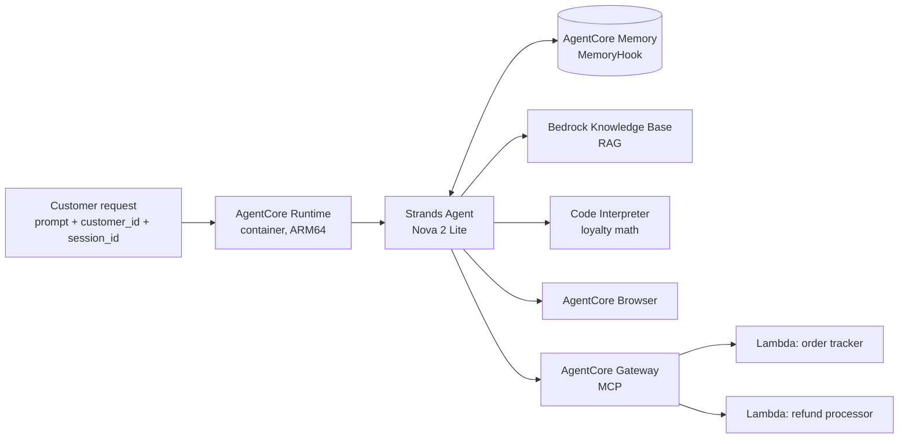

# Customer Support AI Agent — Amazon Bedrock AgentCore + Strands

A customer-support agent for an e-commerce store, deployed on **Amazon Bedrock AgentCore Runtime**. It tracks orders, processes refunds, answers policy questions from a knowledge base, remembers customers across sessions, calculates loyalty discounts with exact arithmetic, and can browse the web.

> Built as the **Course 3 project ("AI Support Agent")** of the *Future AWS Agent Engineer* program (AWS AI & ML Scholars, Udacity) — *Building Agents with Amazon Bedrock AgentCore and Strands SDK*. It passed Udacity's project review on the first attempt (Sept 20, 2026). `main.py` is my completed solution, built on the course's starter scaffolding; the mock Lambda functions and product catalog were supplied by the course and are **not** included in this repo.

---

## What the agent can do

| Capability | How it is implemented |
|---|---|
| Order tracking, customer lookup, refunds, return labels | Lambda functions exposed as **MCP tools** through an **AgentCore Gateway** (`initiate_refund`, `check_refund_status`, `get_return_label`, plus order/customer lookups) |
| Product, warranty and loyalty-policy questions | **RAG** over an Amazon Bedrock **Knowledge Base** (`search_knowledge_base` tool) |
| Remembers name and preferences across sessions | **AgentCore Memory** (short-term + long-term) wired in through a custom Strands `HookProvider` |
| Exact loyalty-discount math | **AgentCore Code Interpreter** sandbox (`calculate_loyalty_discount` tool) with a safe fallback |
| Live web lookups | **AgentCore Browser** tool |
| Monitoring | AgentCore observability / CloudWatch logs |

**Model:** Amazon Nova 2 Lite (`global.amazon.nova-2-lite-v1:0`) via the **Strands Agents SDK**. **Region:** `us-east-1`.

## Architecture



## Design decisions

**1. Loyalty math runs as code, not as model output.**
The rules are exact: 100 points = $1, redemption in steps of 500 points, points cover at most 50% of the order, and the tier discount (Silver 0%, Gold 10%, Platinum 15%) applies *after* points. A language model can slip on arithmetic; code in a sandbox returns the same answer every time. Tool inputs are JSON-encoded before being placed in the sandbox code so they cannot inject code. If the interpreter is unavailable, a fallback applies only the tier discount, so the tool still answers.

Worked example (Gold member, 4,250 points, $150 order): **4,000 points redeemed → $40 off → 10% of the remaining $110 = $11 → final total $99.00, 250 points left.**

**2. Memory is injected and saved by hooks, not by the model.**
`MemoryHook` retrieves relevant memories from every strategy namespace and prepends them to the user's message, then saves each completed turn after the response. It saves the customer's *original* text, so injected context is never written back into memory.

**3. Least-privilege IAM.**
The execution role created by the toolkit could not query the Knowledge Base or use the browser, so I added narrowly scoped inline policies (for example only `bedrock:Retrieve` on my own knowledge base) instead of broad permissions.

More detail, including the deployment problems I debugged, is in [`docs/REFLECTION.md`](docs/REFLECTION.md).

## Demo

Real output from the deployed agent (AWS account details are blacked out).

| Test | What it shows | Screenshot |
|---|---|---|
| Order tracking | Status, carrier and tracking number from the Gateway tool | [01](docs/screenshots/01-order-tracking.png) |
| Refund | Refund approved with an ID and 3–5 business-day timeline | [02](docs/screenshots/02-refund.png) |
| Knowledge Base (RAG) | Platinum-tier benefits retrieved from the catalog | [03](docs/screenshots/03-knowledge-base-rag.png) |
| Memory | The agent addresses the user by name, and a separate invocation with `session_id: s-B` recalls her name and "concise responses" preference | [04](docs/screenshots/04-memory-personalised-reply.png), [05](docs/screenshots/05-memory-recall-session-b.png) |
| Loyalty discount | Code Interpreter result: $99.00 final total, 4,000 points used | [06](docs/screenshots/06-loyalty-discount.png), [07](docs/screenshots/07-loyalty-discount-breakdown.png) |
| Browser | Reads the live page title of udacity.com | [08](docs/screenshots/08-browser-tool.png) |

## Run it yourself

You need your own AWS account with the resources below in `us-east-1`; this repo only contains the agent code.

1. Create a Lambda-backed **AgentCore Gateway**, a **Bedrock Knowledge Base** (loaded with a product/policy document) and an **AgentCore Memory** resource.
2. Set the IDs as environment variables (see [`.env.example`](.env.example)): `GATEWAY_URL`, `KB_ID`, `MEMORY_ID`.
3. Install and test locally (Python 3.14+, [uv](https://docs.astral.sh/uv/)):
   ```bash
   uv sync
   python check_gateway.py        # lists the tools exposed by your Gateway
   ```
   For a local CLI run, comment out `app.run()` at the bottom of `main.py` and uncomment `main()`, then `uv run main.py '{"prompt": "Hello", "customer_id": "CUST-123", "session_id": "s1"}'`.
4. Deploy with the AgentCore CLI (`.bedrock_agentcore.yaml.example` shows the shape of the generated config) and invoke:
   ```bash
   agentcore invoke '{"prompt": "Track order ORD-001", "customer_id": "CUST-123", "session_id": "t1"}'
   ```

## Known limitations and next steps

- **Gateway authorization was "none"** — acceptable only in a sandbox. For production: IAM or JWT auth on the Gateway.
- **Refund amount:** the refund tool's `amount` field is optional and defaults to `0` when the agent does not pass it (visible in screenshot 02). A production version should look the amount up from the order.
- The browser test used udacity.com rather than a retail site.
- No CloudWatch alarm is included in this repo.
- The deployed endpoint is not public, so the screenshots above are the demo.
- Config values were moved from hard-coded constants to environment variables when this repo was prepared for publishing; that refactor has not been re-deployed.
